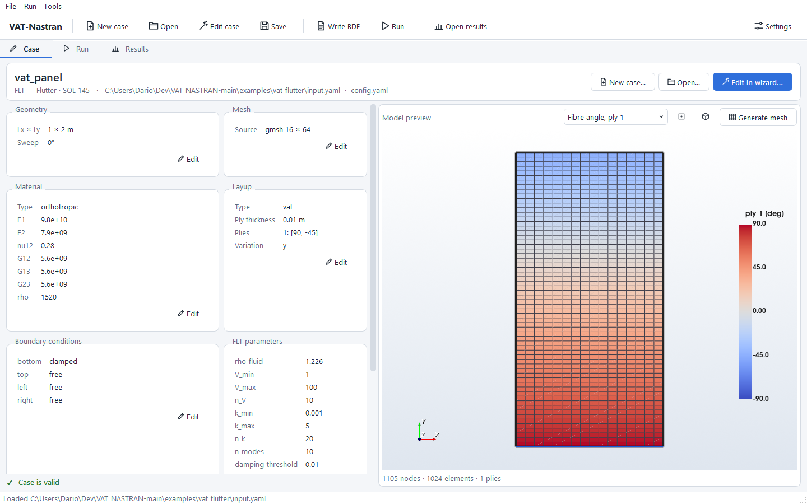
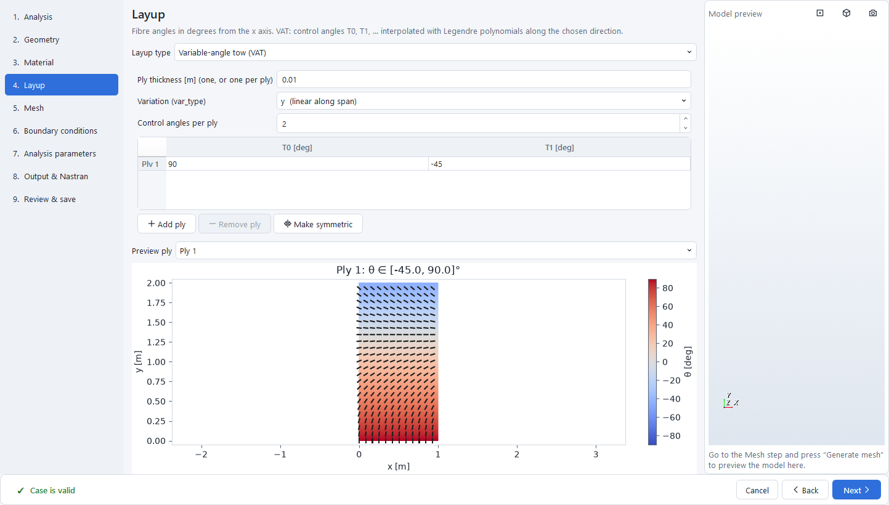
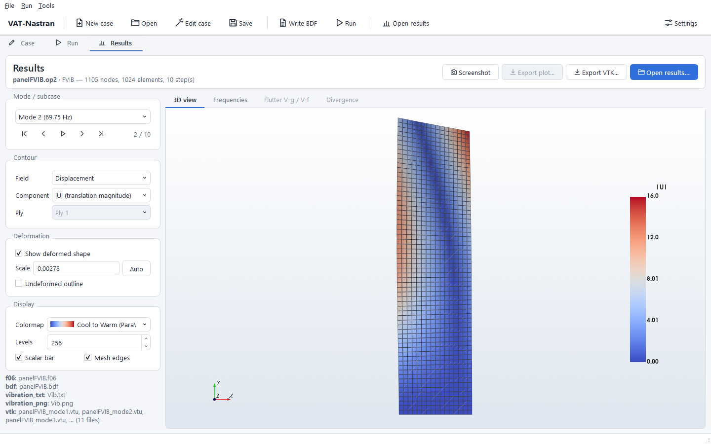
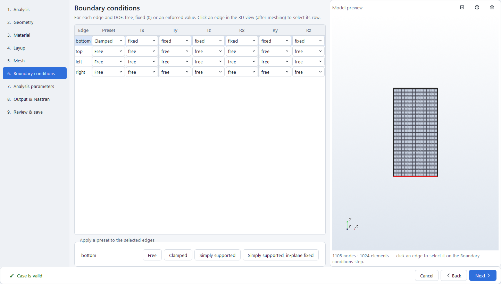
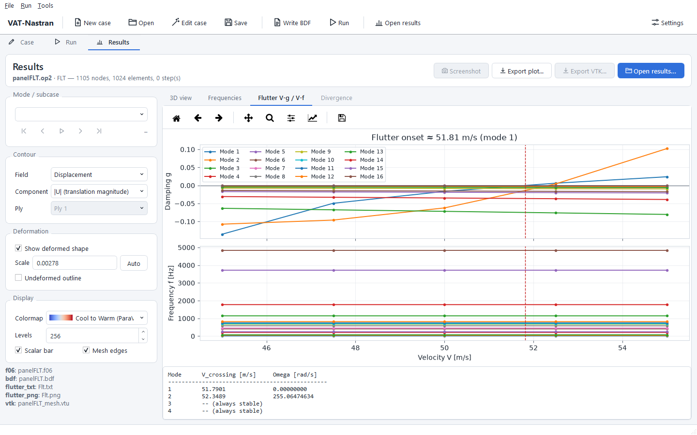

<p align="center">
  
</p>

<h1 align="center">VAT-Nastran</h1>

<p align="center">
  A desktop pre- and post-processor for <b>MSC Nastran</b> analyses of flat and swept panels:<br>
  isotropic plates, straight-fibre laminates and <b>Variable Angle Tow (VAT)</b> composites.<br>
  Statics · normal modes · static aeroelasticity &amp; divergence · flutter.
</p>

<p align="center">
  <a href="../../releases/latest"><b>⬇ Download the latest Windows installer</b></a>
  &nbsp;·&nbsp;
  <a href="#contact">Contact</a>
</p>



## What it does

You describe a panel in a step-by-step wizard, or in two short text files.
VAT-Nastran then:

1. meshes the panel,
2. computes the fibre-angle field of each VAT ply,
3. writes the Nastran input deck,
4. launches MSC Nastran,
5. shows the results: mode shapes, flutter diagrams, divergence and static reports,
   ParaView files.

| Analysis | Nastran SOL |
|---|---|
| Linear statics with enforced edge displacements / rotations | 101 |
| Normal modes / free vibration | 103 |
| Static aeroelastic trim and divergence | 144 |
| Flutter (PK method) | 145 |

## Features

**Modelling**
- Rectangular or swept panels, with a structured quad mesh generated automatically.
  An existing mesh can also be imported.
- Materials: isotropic, or an orthotropic composite lamina.
- Layups:
  - isotropic shell;
  - straight-fibre laminate with any stacking sequence;
  - **VAT laminate**. The fibre angle of each ply varies smoothly over the panel through
    control angles `[T0, T1, …]`, along the chord or the span.
- Boundary conditions per edge (root, tip, leading edge, trailing edge) and per degree
  of freedom: free, fixed or an enforced displacement / rotation. Edges can be picked
  directly on the mesh.
- Every input is checked before the run, with clear messages, e.g.
  `material.E1: must be > 0`.

**Running**
- MSC Nastran runs in the background, with a progress bar and the live solver log.
  It can be cancelled at any time.
- You can also write only the Nastran deck (`.bdf`) and run it elsewhere.
- **Parametric sweeps** of the VAT control angles `(T0, T1)` run many flutter analyses
  in one go and collect a summary.

**Post-processing**
- Results are read from both MSC Nastran output formats, HDF5 (`.h5`) and OP2 (`.op2`).
  The `.f06` tables are parsed for frequencies, flutter and divergence.
- **Post-process only:** you can load results computed earlier, or on another machine,
  without running Nastran again.
- 3D viewer:
  - deformed shapes and mode shapes, animated;
  - previous / next mode buttons and keyboard shortcuts;
  - contours of displacement components and of the fibre angle of each ply;
  - ParaView-like *Cool to Warm* colormap by default, with viridis, turbo, jet and others
    available.
- **Flutter:**
  - V-g and V-f diagrams;
  - automatic detection of the flutter onset velocity for each mode;
  - text tables ready for reports.
- Natural frequency tables, divergence pressures and velocities, and static reports at
  the node of maximum deflection.
- **ParaView export:**
  - one `.vtu` file per mode plus a `.pvd` collection, so ParaView's *Next Frame* button
    steps through the modes;
  - the fibre angle of every ply is included.
- Screenshots of the 3D view and export of the plots.

**Usability**
- The wizard opens in its own window and shows live previews of the mesh, the
  fibre-angle field and the selected edges.
- Light, dark and other colour themes, with a custom accent colour.
- A Settings dialog for:
  - the Nastran executable, with a **Test** button that also checks the licence server;
  - the default colormap, colour levels, deformation scale and background.
- A command-line tool (`vatnastran`) is also installed, for scripts and batch runs.

| Wizard | Results |
|---|---|
|  |  |
|  |  |

## Requirements

- Windows 10 or 11, 64-bit.
- **MSC Nastran** 2016 or later (tested with MSC Nastran 2024.1), with a valid licence,
  to run analyses. Without Nastran you can still build models, write Nastran decks and
  post-process existing results.
- Nothing else: Python and all libraries are included in the installer.

## Installation

1. Download `VAT-Nastran-<version>-setup.exe` from the
   [latest release](../../releases/latest).
2. Run it. A per-user installation needs no administrator rights. The installer:
   - lets you choose the installation folder;
   - asks for the path of `nastran.exe`. It proposes the newest MSC Nastran found on the
     machine, and you can leave it empty and set it later in **Settings**;
   - installs four **ready-to-run examples** and a **guide** in a folder of your choice,
     by default `Documents\VAT-Nastran`;
   - creates Start-menu entries for the program, the guide and the examples. A desktop
     icon and adding the `vatnastran` command to the PATH are optional.
3. Open the guide from the Start menu and run the first example.

Unattended installation, e.g. on lab machines:

```bat
VAT-Nastran-1.0.0-setup.exe /VERYSILENT /CURRENTUSER /DATADIR="D:\VAT-Nastran" /NASTRAN="C:\Program Files\MSC.Software\MSC_Nastran\2024.1\bin\nastran.exe" /TASKS=addtopath
```

To uninstall, use *Settings → Apps* or the Start-menu entry. Your examples folder and
its results are kept.

## Included examples

| Example | Model | Analysis |
|---|---|---|
| `isotropic_static` | Aluminium plate, clamped root, enforced tip deflection | Linear statics |
| `straight_modes` | Carbon/epoxy `[0/45/-45/90]s` cantilever laminate | Normal modes |
| `swept_vat_divergence` | 20° swept wing-like panel, 3 VAT plies | Divergence |
| `vat_flutter` | 1 × 2 m VAT panel, fibre angle from 90° (root) to -45° (tip) | Flutter |

Any model can be run with any analysis type.

## Contact

The source code is not public. To ask for information, request new features or changes,
or report a bug, please contact:

**Dario Campagna**, University of Palermo, [dario.campagna@unipa.it](mailto:dario.campagna@unipa.it)

When you report a bug, please include:
- the VAT-Nastran version (shown in *Settings → Apps*, or by `vatnastran --version`) and
  your MSC Nastran version;
- what you did and what happened, with any error message or a screenshot;
- if possible, the `input.yaml` and `config.yaml` of the case, and the `.f06` / `.log`
  files written by Nastran.

You can also open an [issue](../../issues) on this repository.

## License

Released under the [MIT License](LICENSE).

MSC Nastran is a product of Hexagon / MSC Software and is not included. A licensed
installation is required to run analyses.
